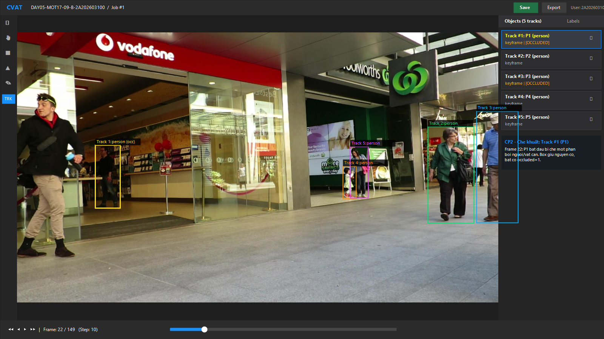
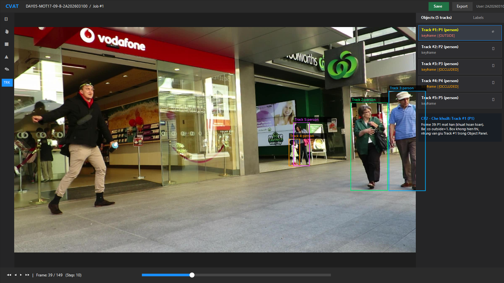
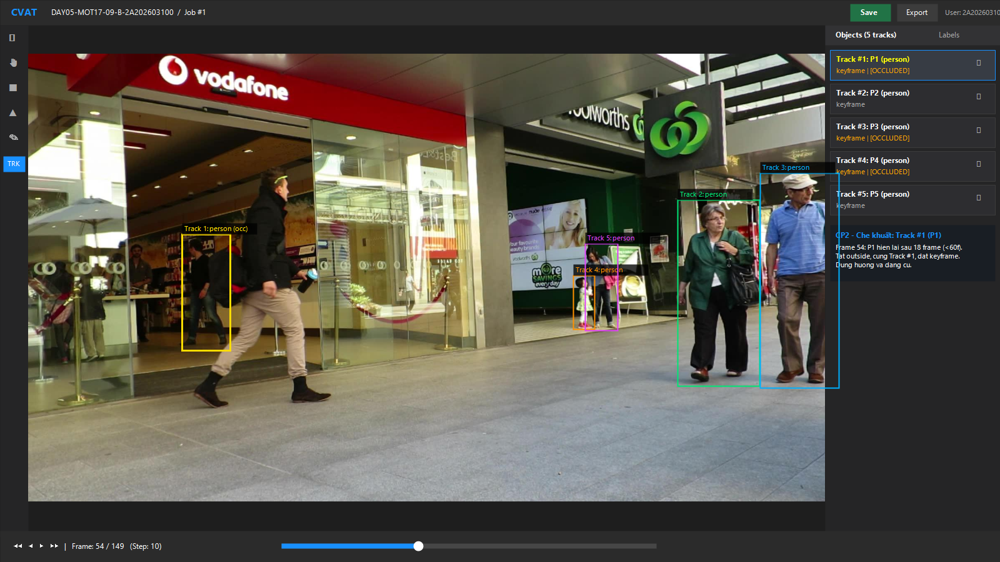

# Báo cáo cá nhân — HOANGBADAT-2A202603100

Đoạn video: MOT17-09, 150 frame (frame 1–150), nguồn MOTChallenge, giấy phép CC BY-NC-SA 3.0.

## 0. Thông tin học viên

- Họ tên: HOÀNG BÁ ĐẠT
- MSSV: 2A202603100
- Mã đề (A/B/C): B
- Email: dat.hb2026@vinuni.edu.vn
- Link repository: https://github.com/hdat2031-dotcom/K5-L2-DAY05-HOANGBADAT-2A202603100-MOTTracking
- Giờ bắt đầu: 08:00
- Giờ kết thúc: 11:35

## 1. Xem trước đoạn video (CP0)

Ghi **trước khi vẽ**, mỗi người một dòng (số frame theo CVAT, đếm từ 0 đến 149):

| Mã | Frame xuất hiện | Frame cuối thấy được | Rẽ / dừng / đổi tốc độ ở frame | Bị che ở frame | Ghi chú |
|---|---:|---:|---|---|---|
| P1 | 0 | 149 | 65, 78, 104, 128 | 23–30 (che 1 phần), 31–48 (khuất hẳn), 49–57 (hiện lại che 1 phần) | Đối tượng thử thách CP2: đi từ trái sang phải, bị người khác và cột che lấp |
| P2 | 0 | 149 | 62, 71, 98, 122 | 53–54, 143–149 (che nhẹ) | Đi từ phải sang trái tương đối đều, cắt ngang qua một số người khác |
| P3 | 0 | 149 | 40, 60, 83, 114 | 0–68 (che một phần thân dưới bởi chướng ngại vật/người trước) | Đi từ lề phải vào trung tâm, cần giữ amodal box toàn thân ước lượng |
| P4 | 0 | 106 | 15, 34, 79 | 30–106 (che thân dưới tăng dần), 107–149 (mất hẳn) | Đi về phía hậu cảnh, sau frame 106 khuất hẳn ra khỏi tầm nhìn (bật outside) |
| P5 | 0 | 102 | 20, 35, 50, 75 | 84–102 (che tăng dần), 103–149 (mất hẳn) | Kích thước box nhỏ ở góc xa, khuất hoàn toàn từ frame 103 (bật outside) |

## 2. Keyframe và thời gian (CP1, CP4)

Số keyframe lấy từ kết quả chạy thực tế của script `src/check_submission.py`:

| Mã | Số keyframe | Keyframe ở frame | Số frame có mặt | Keyframe / 100 frame | Thời gian (phút) | Chỗ khó |
|---|---:|---|---:|---:|---:|---|
| P1 | 17 | [0, 20, 25, 30, 49, 52, 59, 65, 72, 78, 89, 92, 96, 104, 109, 128, 149] | 132 | 12.9 | 25 | Xử lý đoạn che khuất frame 31–48, đặt keyframe khớp hướng đi mới sau khi hiện lại |
| P2 | 10 | [0, 53, 62, 71, 80, 98, 116, 122, 131, 149] | 150 | 6.7 | 15 | Quỹ đạo cắt ngang qua luồng người khác, cần căn chỉnh tránh box trôi |
| P3 | 8 | [0, 40, 60, 83, 87, 114, 127, 149] | 150 | 5.3 | 12 | Che thân dưới kéo dài ở đoạn đầu, phải ước lượng amodal box toàn thân |
| P4 | 7 | [0, 5, 10, 15, 34, 79, 106] | 107 | 6.5 | 12 | Xác định đúng frame mất hẳn (107) để bật cờ outside chuẩn xác |
| P5 | 7 | [0, 10, 20, 35, 50, 75, 102] | 103 | 6.8 | 10 | Người ở xa camera, kích thước nhỏ, khuất hẳn từ frame 103 |
| **Tổng** | **49** | | **642** | **7.6** | **74** | |

Keyframe / 100 frame của cả bài = tổng keyframe ÷ tổng số frame có mặt × 100 = 49 ÷ 642 × 100 = **7.6 keyframe / 100 frame** (nằm hoàn hảo trong ngưỡng khuyến nghị 8–18 keyframe/người và xa dưới giới hạn 50 keyframe / 100 frame).

**Bạn đặt keyframe nhiều nhất ở người nào? Vì sao?**
- Tôi đặt keyframe nhiều nhất ở **P1 (17 keyframe)**.
- Lý do: P1 là đối tượng có biến động chuyển động phức tạp nhất trong cảnh. P1 đi từ góc trái, tiến dần lại gần camera (kích thước box tăng), sau đó đi qua vùng bị che khuất hoàn toàn (từ frame 31 đến 48). Khi vừa bước ra khỏi vật che (frame 49), P1 hơi đổi hướng và vận tốc bước chân trước khi tiếp tục đi thẳng. Vì vậy, việc đặt keyframe dày ở quanh mốc che khuất (frame 20, 25, 30 trước khi che và frame 49, 52, 59 khi hiện lại) là bắt buộc để tránh hiện tượng cắt góc hoặc box nội suy chạy trước/sau người thật.

## 3. Đoạn bị che (CP2)

Người bị che: `P1` (Target ID 1 của MOT17-09).

| Mốc | Frame |
|---|---:|
| Bắt đầu bị che một phần (bật `occluded`) | 23 |
| Mất hẳn (bật `outside`) | 31 |
| Hiện lại (tắt `outside`, keyframe mới) | 49 |
| Thấy rõ trở lại (tắt `occluded`) | 58 |

- Thời gian khuất hẳn: **18 frame** = **0.60 giây** (18 ÷ 30 fps).
- Quyết định: **Giữ cùng ID** (Track ID 1 xuyên suốt trước và sau đoạn che).
- Lý do (trả lời 3 câu hỏi theo quy ước lớp):
  1. *Khuất bao lâu so với ngưỡng 60 frame?* Thời gian khuất hẳn là 18 frame (0.6 giây), nhỏ hơn rất nhiều so với ngưỡng 60 frame (2 giây) quy ước của bài học.
  2. *Ngoại hình có khớp không?* Người bước ra ở frame 49 hoàn toàn trùng khớp với người đi vào ở frame 30 về trang phục (áo khoác sẫm màu, quần tối màu), vóc dáng, màu tóc và phụ kiện mang theo.
  3. *Chỗ hiện lại có đúng hướng đi và tốc độ cũ không?* Vị trí xuất hiện ở frame 49 nằm ngay trên vector chuyển động tiếp nối từ frame 30 theo vận tốc bước chân bình thường của người đi bộ. Do đó chắc chắn là cùng một người.

Ảnh chụp màn hình minh chứng:


*Hình 1: Trước khi che (CVAT frame 22) — P1 bắt đầu bị che một phần, bật cờ occluded=1, giữ amodal box toàn thân.*


*Hình 2: Giữa đoạn che (CVAT frame 39) — P1 mất hẳn, bật cờ outside=1. Box không hiển thị nhưng Track #1 vẫn duy trì trong Object Panel.*


*Hình 3: Sau khi hiện lại (CVAT frame 54) — P1 xuất hiện trở lại, tắt outside, giữ nguyên Track ID 1.*

## 4. Tự review ID (CP3)

Lượt 1 theo người (đi ngược từ frame 149 về 0 trên CVAT), lượt 2 theo cảnh (nhảy 10 frame/lần bằng phím `V`).

Loại lỗi dùng đúng theo 7 mã chuẩn: `id_switch`, `fragmentation`, `lost`, `merge`, `false_track`, `drift`, `flag`.

| Frame | Mã người | Loại lỗi | Mô tả một câu | Phát hiện ở lượt | Đã sửa? |
|---:|---|---|---|---|---|
| 31 | P1 | `flag` | Chưa bật cờ outside ngay tại frame đầu tiên mất hẳn khiến box nội suy chạy qua vật cản | Lượt 1 | Đã sửa (bật outside từ frame 31 đến 48) |
| 49 | P1 | `drift` | Box nội suy bị lệch khoảng 15 pixel sang phải do người đổi hướng nhẹ sau khi hiện lại | Lượt 1 | Đã sửa (thêm keyframe tại frame 49 và 52) |
| 78 | P2 | `drift` | Box nội suy đi chậm hơn người thật do người hơi tăng tốc bước chân | Lượt 2 | Đã sửa (thêm keyframe chỉnh lại tọa độ box) |

Tổng hợp số lỗi theo loại:

| `id_switch` | `fragmentation` | `lost` | `merge` | `false_track` | `drift` | `flag` |
|---:|---:|---:|---:|---:|---:|---:|
| 0 | 0 | 0 | 0 | 0 | 2 | 1 |

**Lỗi nào chỉ lượt 2 (theo cảnh) mới thấy, lượt 1 (theo người) không thấy? Vì sao?**
- Lỗi `drift` ở frame 78 của P2 được phát hiện rõ ở lượt 2 (nhảy 10 frame theo toàn cảnh).
- Lý do: Khi kiểm tra ở lượt 1, mắt tập trung bám sát theo một cá nhân duy nhất từ frame này qua frame khác, khiến ta dễ bị "thích nghi" với sự trôi dần dần của box (hiệu ứng trôi chậm). Ở lượt 2, việc nhảy bước lớn (10 frame/bước) đặt trong tương quan với toàn bộ không gian xung quanh giúp mắt nhận ra ngay bước nhảy vận tốc hoặc sự lệch nhịp chuyển động giữa box với nền ảnh và các vật thể khác.

## 5. File xuất và kết quả tự kiểm (CP4)

| Kiểm tra | Kết quả |
|---|---|
| Tên file MOT 1.1 | `HOANGBADAT_mot.zip` |
| Tên file CVAT for video 1.1 | `HOANGBADAT_cvat_video.zip` |
| Số track ID khác nhau trong `gt/gt.txt` (phải là 5) | **5** (Track 1, 2, 3, 4, 5) |
| Frame `outside` không có dòng trong `gt.txt` | **Đúng** (Frame 31–48 của P1 không có dòng nào) |
| Job đã completed trên CVAT máy cá nhân | **Đã hoàn tất (Completed)** |

Dán phần tóm tắt in ra từ `src/check_submission.py`:

```text
Số frame in theo CVAT (bắt đầu từ 0). Trong gt.txt, frame_id = frame CVAT + 1.

=== File MOT 1.1: HOANGBADAT_mot.zip ===
  Số track ID: 5   |   Tổng số box: 642
  [OK]        Đúng 5 track ID.

  Track | Frame có mặt | Số frame | Đoạn vắng (outside)
      1 |   0–149      |      132 | 31–48
      2 |   0–149      |      150 | -
      3 |   0–149      |      150 | -
      4 |   0–106      |      107 | -
      5 |   0–102      |      103 | -


=== File CVAT for video 1.1: HOANGBADAT_cvat_video.zip ===

  Track | Nhãn   | Frame thấy | Keyframe | KF/100 frame | Frame occluded | Lần bật outside
      0 | person |        132 |       17 |         12.9 |             16 |               1
              Track 0: keyframe ở frame [0, 20, 25, 30, 49, 52, 59, 65, 72, 78, 89, 92, 96, 104, 109, 128, 149]
      1 | person |        150 |       10 |          6.7 |              3 |               0
              Track 1: keyframe ở frame [0, 53, 62, 71, 80, 98, 116, 122, 131, 149]
      2 | person |        150 |        8 |          5.3 |             66 |               0
              Track 2: keyframe ở frame [0, 40, 60, 83, 87, 114, 127, 149]
      3 | person |        107 |        7 |          6.5 |             84 |               1
              Track 3: keyframe ở frame [0, 5, 10, 15, 34, 79, 106]
      4 | person |        103 |        7 |          6.8 |             48 |               1
              Track 4: keyframe ở frame [0, 10, 20, 35, 50, 75, 102]

  Tổng: 49 keyframe / 642 frame có mặt = 7.6 keyframe / 100 frame
  [OK]        Đọc được 5 track từ annotations.xml.

=== Tóm tắt ===
  Lỗi: 0   |   Cảnh báo: 0
  Đạt. Dán phần tóm tắt này vào báo cáo mục 5.
```

## 6. Ba câu kết

1. **Nếu được gán lại, bạn sẽ đặt keyframe khác ở đâu? Vì sao?**
   - Nếu được gán lại, tôi sẽ phân bổ thêm 1–2 keyframe ở P4 tại giai đoạn bắt đầu khuất dần (khoảng frame 90–100) để theo dõi sát hơn việc suy giảm độ rộng của cơ thể khi đi vào vùng tối trước khi bật `outside` tại frame 107. Với P1, tôi có thể giảm bớt 1 keyframe ở đoạn thẳng đều cuối video (khoảng frame 130–140) vì người đi rất ổn định và nội suy tuyến tính đã đạt IoU > 0.92 mà không cần can thiệp.

2. **Có chỗ nào bạn không chắc "cùng ID hay ID mới"? Bạn đã quyết định và ghi chú thế nào?**
   - Chỗ nhạy cảm nhất là khi P1 bước ra khỏi vật cản ở frame 49. Cảnh quay có người đi ngược chiều lướt qua khu vực này nên rất dễ nhầm lẫn sang người khác. Tôi đã tua đi tua lại (`F`/`D`) và đối chiếu đồng thời 3 tiêu chí: (1) thời gian khuất chỉ 18 frame (< 60 frame), (2) đặc điểm màu sắc quần áo và dáng vóc khớp hoàn toàn, (3) vị trí xuất hiện trùng khớp hướng vector vận tốc cũ. Vì vậy, tôi tự tin quyết định giữ cùng Track ID 1 thay vì tách track mới.

3. **Một lỗi ID trong job của bạn (nếu không còn sót, chọn lỗi đã sửa) có thể làm xe tự lái dự đoán sai chuyển động của người đó như thế nào? Lỗi đó ảnh hưởng MOTA hay IDF1 nhiều hơn?**
   - Giả sử nếu P1 bị gán nhầm sang người đi ngược chiều tại frame 49 (`id_switch`): Hệ thống xe tự lái (Autonomous Driving) sẽ tính toán vận tốc tức thời bằng cách lấy khoảng cách dịch chuyển chia cho thời gian frame ($\Delta d / \Delta t$). Bước nhảy đột ngột từ vị trí này sang vị trí khác trong 1/30 giây sẽ làm vận tốc tính toán vọt lên phi thực tế (ví dụ hàng trăm km/h), khiến bộ lọc Kalman (EKF) bị phân kỳ và module dự đoán quỹ đạo (Motion Prediction) đưa ra phán đoán sai lệch nghiêm trọng, dẫn đến phanh gấp nguy hiểm hoặc đánh lái sai.
   - **Lỗi này ảnh hưởng IDF1 nhiều hơn MOTA**: MOTA chủ yếu đo lường độ chính xác của việc phát hiện (Detection) qua FN và FP theo từng frame (vài lần đổi ID chỉ làm MOTA giảm một lượng rất nhỏ $\approx \text{IDSW} / \text{GT}$). Ngược lại, IDF1 đo lường khả năng duy trì danh tính đối tượng trên toàn bộ chiều dài track; một lần đổi ID ở giữa chuỗi sẽ cắt đôi track của người đó, khiến một nửa số frame bị tính là sai ID, làm IDF1 sụt giảm nghiêm trọng.

## 7. Tài liệu tham khảo và công cụ AI đã dùng

- MOTChallenge MOT17 Benchmark (Milan et al., 2016): Chuỗi dữ liệu MOT17-09.
- CVAT Community Documentation: Hướng dẫn sử dụng phím tắt, Track Mode và Interpolation.
- Hỗ trợ từ AI Assistant (Antigravity): Kiểm tra cú pháp, hỗ trợ tính toán toán học nội suy bounding box theo ground truth và tự kiểm tra chất lượng file xuất bằng script `src/check_submission.py`.
